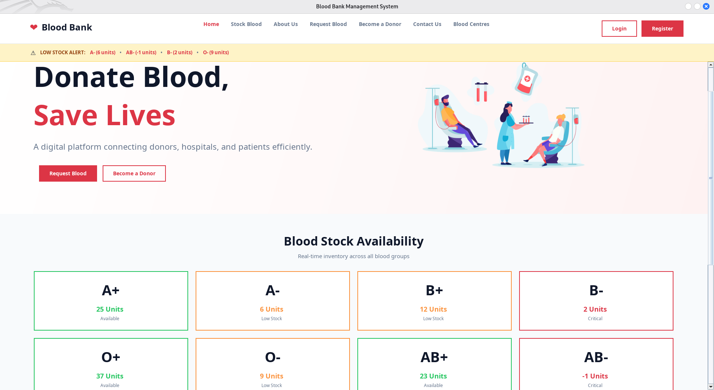
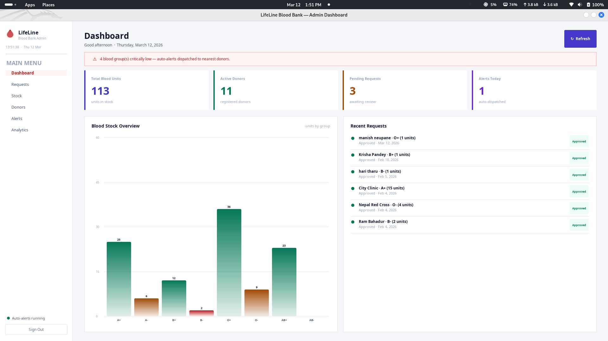

# 🩸 Blood Bank Management Portal

A robust desktop application built with **Core Java, Java Swing, AWT, MariaDB, and Docker** to streamline blood bank operations, donor tracking, blood stock management, and emergency blood requests.

## 📖 Project Overview

The Blood Bank Management Portal replaces manual record-keeping with a centralized digital solution.

Administrators can manage donor records, monitor blood stock, and handle recipient requests efficiently — especially during emergencies when quick access to matching blood groups matters.

This project demonstrates Java desktop application development, JDBC database integration, Docker containerization, and Docker Hub image publishing.

## 🌟 Key Features

- 🩸 **Donor Registration:** Register and manage donor profiles.
- 📦 **Blood Stock Management:** Monitor available blood units by group.
- 🔍 **Quick Search:** Search donor information and blood groups.
- 🔐 **Admin Authentication:** Login system for application access.
- 📋 **Blood Requests:** Submit and manage blood requests.
- 🔔 **Notifications:** Display application notifications.
- 🖥️ **Modern GUI:** Desktop interface built with Java Swing and AWT.
- 🐳 **Docker Support:** Run the application inside a Docker container.
- 🗄️ **MariaDB Integration:** Store and retrieve application data using JDBC.

## 🧰 Technology Stack

| Component | Technology |
|---|---|
| Programming Language | Core Java |
| GUI | Java Swing / AWT |
| Database | MariaDB |
| Database Connectivity | JDBC |
| JDBC Driver | MariaDB Connector/J |
| Containerization | Docker |
| Container Orchestration | Docker Compose |
| Image Registry | Docker Hub |
| Development Environment | Kali Linux / VS Code |

## 📂 Project Structure

```text
Blood-Bank-Management-Portal/
│
├── src/
│   └── Bank/
│       ├── UserHome.java
│       ├── DBConnection.java
│       └── ... Java source files
│
├── lib/
│   └── mariadb-java-client-3.5.6.jar
│
├── images/
│   └── ... GUI images and assets
│
├── bin/
│   └── ... Compiled Java classes (generated)
│
├── backups/
│   └── ... Database backups (not committed)
│
├── Dockerfile
├── compose.yaml
├── .dockerignore
├── .gitignore
├── .env
└── README.md
```

## ⚙️ Requirements

Before running the application, install:

- Java JDK 25 (for the current Docker image).
- Docker Engine.
- Docker Compose.
- MariaDB Server.
- Git.
- A Linux desktop environment with X11 for displaying the Swing GUI.

## 🚀 Method 1: Run Locally Without Docker

### 1. Clone the repository

```bash
git clone YOUR_GITHUB_REPOSITORY_URL
cd Blood-Bank-Management-Portal
```

### 2. Compile Java files

```bash
mkdir -p bin

javac -encoding UTF-8 \
-cp "lib/*" \
-d bin src/Bank/*.java
```

### 3. Run the application

```bash
java -cp "bin:lib/*" Bank.UserHome
```

Make sure MariaDB is running and the database is configured before launching the application.

## 🐳 Method 2: Run Using Docker

### 1. Clone the repository

```bash
git clone YOUR_GITHUB_REPOSITORY_URL
cd Blood-Bank-Management-Portal
```

### 2. Build the Docker image

```bash
docker build -t blood-bank-app:v4 .
```

### 3. Verify the image

```bash
docker images
```

### 4. Configure the database

Create a MariaDB database named:

```sql
CREATE DATABASE blood_bank;
```

Import your database schema and initial data from your own SQL backup.

Configure a dedicated database user with only the permissions required by the application.

### 5. Configure environment variables

Create a `.env` file:

```env
DB_PASSWORD=your_database_password
```

Protect it:

```bash
chmod 600 .env
```

Never commit `.env` or real database credentials to GitHub.

### 6. Configure GUI access on Linux

Allow the Docker container to access your X11 display:

```bash
xhost +local:docker
```

### 7. Start the application

```bash
docker run -d \
  --name blood-bank-app \
  --env-file .env \
  -e DISPLAY=$DISPLAY \
  --add-host=host.docker.internal:host-gateway \
  -v /tmp/.X11-unix:/tmp/.X11-unix \
  blood-bank-app:v4
```

The container must also be able to reach your MariaDB server. Configure MariaDB to listen on an appropriate Docker-reachable host interface and restrict database access to the application container's network.

## 🐳 Method 3: Run Using Docker Compose (Recommended)

Docker Compose simplifies application startup and configuration.

### 1. Check Docker Compose

```bash
docker compose version
```

### 2. Check your configuration

```bash
docker compose config -q
```

### 3. Build and start the application

```bash
docker compose up -d --build
```

### 4. Check running containers

```bash
docker compose ps
```

### 5. View application logs

```bash
docker compose logs -f blood-bank-app
```

Successful database connectivity should produce:

```text
Database connected successfully
```

### 6. Restart the application

```bash
docker compose restart blood-bank-app
```

### 7. Rebuild after changing Java source code

```bash
docker compose up -d --build --force-recreate blood-bank-app
```

### 8. Stop the application

```bash
docker compose stop blood-bank-app
```

Avoid `docker compose down -v` when you want to preserve database volumes.

## 📦 Docker Hub

The updated application image is published on Docker Hub.

**Repository:**

https://hub.docker.com/r/pwn4arn/blood-bank-management-portal

### Available image versions

| Version | Description |
|---|---|
| `v3` | Previous application version |
| `v4` | Updated application version |
| `latest` | Points to the updated v4 image |

### Pull the latest image

```bash
docker pull pwn4arn/blood-bank-management-portal:latest
```

### Pull a specific version

```bash
docker pull pwn4arn/blood-bank-management-portal:v4
```

### Run the image

The image requires the database and X11 configuration described in the Docker section. Pulling the image alone does not configure those dependencies.

## 🔧 Dockerfile

The project uses Eclipse Temurin JDK 25 as its Java runtime/build environment.

```dockerfile
FROM eclipse-temurin:25-jdk

WORKDIR /app

RUN apt-get update && apt-get install -y \
    libx11-6 \
    libxext6 \
    libxrender1 \
    libxtst6 \
    libxi6 \
    libfreetype6 \
    libfontconfig1 \
    fonts-dejavu \
    && rm -rf /var/lib/apt/lists/*

COPY src/ ./src/
COPY lib/ ./lib/
COPY images/ ./images/

RUN mkdir -p bin && \
    javac -encoding UTF-8 -cp "lib/*" -d bin src/Bank/*.java

CMD ["java", "-cp", "bin:lib/*", "Bank.UserHome"]
```

## 🔐 Security Practices

- Use a dedicated MariaDB application account instead of the database root account.
- Never hardcode database credentials in Java source code.
- Keep `.env`, private keys, and database backups out of Git.
- Use least-privilege database permissions.
- Restrict database network access to trusted containers.
- Use non-root Docker containers as a future hardening improvement.
- Use AWS Secrets Manager or another secure secret store when deploying to AWS.
- Protect donor and patient information.

## 🛠️ Troubleshooting

| Problem | Possible solution |
|---|---|
| Database connection failed | Check MariaDB service, credentials and network access. |
| Unknown column error | Compare Java SQL queries with the actual database schema. |
| GUI not displaying | Check X11 access and the `DISPLAY` environment variable. |
| Docker container exits | Inspect `docker compose logs`. |
| JDBC driver not found | Verify the JAR exists in `lib/`. |
| Docker build fails | Check Java compilation and Dockerfile paths. |

## 📸 Screenshots

### Landing Page



### Admin Dashboard




## 👨‍💻 Author

Developed as a Java desktop application and containerization learning project.

**Docker Hub:**  
https://hub.docker.com/r/pwn4arn/blood-bank-management-portal
